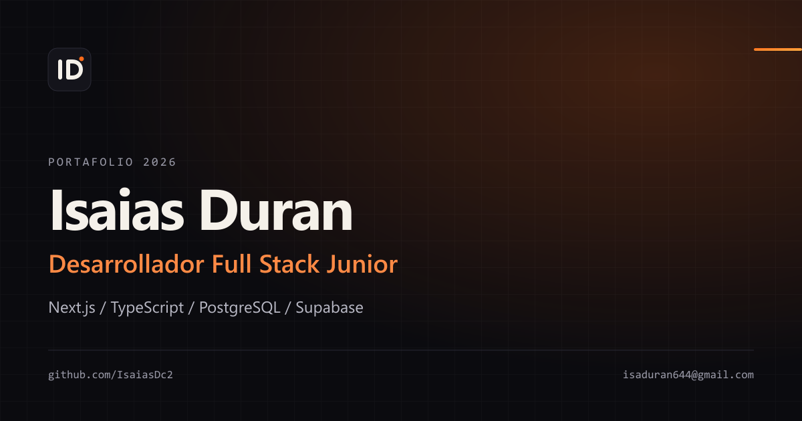

# Isaias Duran · Portfolio

Single-page portfolio for Isaias Duran, a junior full stack developer based in Argentina. It presents two main case studies, two smaller projects, a short profile, the stack, education and a contact form.

The site is in Spanish and English, with a dark and a light theme. All project data comes from real repositories and demos. There are no invented metrics or placeholder testimonials.



## Stack

| Layer | Choice |
| --- | --- |
| Framework | Next.js 16, App Router, Turbopack |
| UI | React 19, TypeScript, Tailwind CSS v4 |
| Motion | `motion/react` |
| Icons | Phosphor Icons |
| Dialog | Radix Dialog |
| Fonts | Space Grotesk, Inter, JetBrains Mono via `next/font` |
| Analytics | Vercel Analytics, enabled only when `VERCEL=1` |

## Run locally

Requires Node.js 20.9 or newer.

```bash
npm install
npm run dev
```

Open `http://localhost:3000`.

```bash
npm run build   # production build
npm run start   # serve the production build
npm run lint    # ESLint
```

## Structure

```text
src/
  app/
    layout.tsx        fonts, metadata, JSON-LD, theme script
    page.tsx          section order
    globals.css       design tokens, components, motion rules
    not-found.tsx     404 page
    robots.ts         robots.txt
    sitemap.ts        sitemap.xml
    manifest.ts       web app manifest
  components/         Navbar, Hero, projects, About, Skills, Education, Contact, Footer
  data/
    site.ts           all ES/EN interface copy and contact data
    projects.ts       featured projects, case studies and smaller projects
    skills.ts         skill groups
    education.ts      timeline
    types.ts          project types
  lib/
    i18n.ts           L10n types
    use-reduced-motion.ts
  assets/images/      optimized WebP screenshots and portrait
public/
  cv.pdf              one-page CV
  og-image.png        1200 × 630 social preview
scripts/
  cv.html             editable source for the CV
  source/             original screenshots and portrait used for the WebP assets
```

## Editing content

Most changes do not touch components.

- **Interface copy, email, GitHub, site URL:** `src/data/site.ts`. Every string uses `{ es, en }`.
- **Projects and case studies:** `src/data/projects.ts`. Keep `links` honest: use `private` or `email` for anything without a public URL.
- **Skills and timeline:** `src/data/skills.ts` and `src/data/education.ts`.
- **Images:** add a WebP to `src/assets/images`, import it in the data file and update the alt text in both languages. Featured images use a 16:10 frame; the portrait uses 4:5. The original PNG/JPG files used for the current WebP assets are in `scripts/source/`.
- **CV:** edit `scripts/cv.html` and regenerate `public/cv.pdf` with any Chromium browser:

```bash
chrome --headless=new --disable-gpu --no-pdf-header-footer \
  --print-to-pdf=public/cv.pdf "file:///absolute/path/to/scripts/cv.html"
```

## Deploy

The site is built for Vercel, but any host that runs Next.js works.

1. Import the repository in Vercel.
2. Set `NEXT_PUBLIC_SITE_URL` to the production URL, for example `https://your-domain.com`. It feeds canonical URLs, Open Graph metadata, JSON-LD, `sitemap.xml` and `robots.txt`.
3. Deploy.

If `NEXT_PUBLIC_SITE_URL` is missing, the code falls back to `https://isaiasduran.vercel.app`. Replace that fallback in `src/data/site.ts` or set the variable before sharing the site.

Vercel Analytics only renders on Vercel. Self-hosted builds make no analytics request.

## Accessibility and performance

- Semantic landmarks, one `h1`, visible focus rings and a skip link.
- Theme and language controls are keyboard accessible.
- The project dialog traps focus, closes with Escape and returns focus to the trigger.
- Form errors are announced and focus moves to the first invalid field. The form never claims to send anything: it opens the visitor's mail client with the message prepared.
- `prefers-reduced-motion` disables reveals, typing and canvas motion without changing the layout.
- Images are local WebP files served through `next/image`; fonts are self-hosted by `next/font`.
- The last local Lighthouse run on the production build scored 100 in Accessibility, Best Practices and SEO.

## Before publishing

These are real gaps in the available data. They are intentionally hidden or marked instead of filled with invented details.

| Item | Current state | Where to update |
| --- | --- | --- |
| Production URL | Fallback `https://isaiasduran.vercel.app` | `NEXT_PUBLIC_SITE_URL` and `src/data/site.ts` |
| LinkedIn | Not shown because the real profile URL is unknown | Add the URL to `src/data/site.ts`, then render it in `Hero` and `Contact` |
| Education institution and year | Timeline says "Formación técnica · Argentina" | `src/data/education.ts` |
| English level | "Inglés técnico", self-assessed, no certificate listed | `src/data/site.ts` and `scripts/cv.html` |
| Professional photo | Cropped from a full-body shot; a brighter headshot would work better | `src/assets/images/portrait.webp` |
| POS demo | Repository and demo are private; available on interview | `src/data/projects.ts` if a public demo is deployed |
| English CV | `public/cv.pdf` is Spanish only | `scripts/cv.html` plus a second PDF |

The POS Multi-Sucursal project uses its real architecture diagram, not a mock screenshot. Forja Gym and Tgamx link to their public demos and repositories.

## Contact

- Email: [isaduran644@gmail.com](mailto:isaduran644@gmail.com)
- GitHub: [github.com/IsaiasDc2](https://github.com/IsaiasDc2)

The copy, images, CV and project case studies belong to Isaias Duran.
